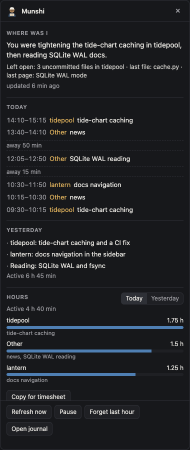
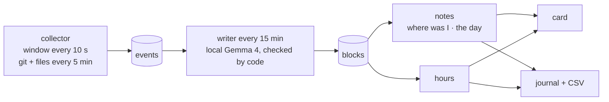

# Munshi

A small munshi (a clerk with spectacles, a cap and a ledger) that sits on your Mac's desktop and keeps your daily work register.
It notes which app, window, repo and files you work on, and a local open-weight model (Gemma 4 e4b through Ollama) turns that into a plain journal.



## The lazy promise

You do nothing. You never write a status update, you never rebuild yesterday from memory, and you never guess your hours. Click the munshi and one card tells you **where you were**, **what you did today and yesterday**, and **your hours per project**, ready to paste into a timesheet.

## Privacy, in plain words

- Everything stays on your Mac. The only network call goes to the model on your own computer; Munshi refuses a remote model address unless you set `allow_remote_model = true` on purpose.
- It records the front app's name, the window title, and for folders you list, git branch, commit subjects and the names of changed files. No screenshots, no keystrokes, no clipboard history, no browser history, no file contents, no diffs.
- Password managers, Keychain Access, System Settings and the lock screen are never recorded, nor any app you add to the ignore list. Private and incognito windows are recorded as the app name only.
- **Title words:** list words such as your employer's name under `ignore_title_words`, and any window whose title (or app name) contains one is not recorded at all, as if the app were ignored. Git repos, commit subjects and file names containing one are dropped too.
- **Process words:** list words under `ignore_process_words`, and any app started with a command line that contains one is not recorded. For Firefox, the name of the profile folder it has open counts too. This keeps a work browser profile out while your personal profile is still recorded.
- Emails, links (only the site name is kept), tokens and long numbers are removed before anything is saved.
- No folders are scanned until you list them. **Pause** stops all recording; **Forget last hour** deletes it.
- Raw window events are deleted after 14 days. The data folder is readable only by you.
- Window titles are treated as data, never as instructions. The model has no tools, and code checks every line it writes; anything that fails becomes a plain code-made line instead.

Why local: a log of every window you open is the most private data on your computer. Rewind, the Mac app that remembered everything, stopped capturing on 2025-12-19 after Meta bought its parent company. This kind of record should not depend on someone else's server or business, and a 4B model on your laptop is enough to label it.

## Start in 60 seconds (demo, no recording)

Needs macOS, [uv](https://docs.astral.sh/uv/), Python 3.13 and [Ollama](https://ollama.com) with the model pulled.

```sh
ollama pull gemma4:e4b
git clone https://github.com/prateek11rai/munshi && cd munshi
uv sync
uv run munshi demo load        # two made-up days
uv run munshi start --demo     # the buddy appears; click it
```

The demo records nothing. **Refresh now** on the card asks the model to write the last few demo slots. Without a Mac, open the same card in a browser with `uv run munshi preview --demo` and go to <http://127.0.0.1:8765>.

To record for real, run `uv run munshi doctor`, give your terminal Accessibility permission (System Settings, Privacy & Security, Accessibility) so window titles can be read, list your code folders under `allowed_roots`, then run `uv run munshi start`.

## How it works



- The **collector** reads the front app and window title every 10 seconds, notices when you are away (3 minutes without input), and every 5 minutes reads git state and changed file names under your listed folders.
- The **writer** takes each finished 15-minute slot, merges repeats and sends the list to the model with stable ids. The model answers JSON (`evidence`, `project`, `topic`, `summary`) under a JSON schema at temperature 0.
- **Code checks every answer**: the evidence ids must exist, the project must be one you have, the topic is at most 4 words, the summary at most 14 words and built from words that appear in the evidence. Times always come from the evidence, never from the model, and digits are stripped from model text, so every number you see was computed by code. A rejected answer, a timeout or a missing model falls back to a code-made line, so the timeline is never empty.
- Projects are found by code first (editor titles ending in a repo name, terminal paths, git events, file folders); the model only fills a project when code found none.
- After each run a "where was I" note is written from the last two hours; when a day ends, a day summary, a Markdown journal page and an hours CSV.

## Commands

| Command | What it does |
|---|---|
| `munshi start [--demo]` | Collector and writer in the background, buddy and card on screen. `--demo` records nothing. |
| `munshi doctor [--demo]` | ✓/✗ for Python, macOS, Ollama, the model, Accessibility, allowed folders, data folder, config. |
| `munshi demo load` / `demo clear` | Two made-up days in `./.data/demo`. |
| `munshi write [--demo]` | Run the writer once and print what it wrote. |
| `munshi journal [--date D] [--demo]` | Write and print a day's journal (default yesterday). |
| `munshi hours [--date D] [--csv] [--demo]` | Hours per project and topic (default today). |
| `munshi pause [--for 30m\|1h]` / `munshi resume` | Pause or resume recording. |
| `munshi forget --last 60m` | Forget recent time. |
| `munshi preview [--demo]` | The card on <http://127.0.0.1:8765> for a browser. |
| `munshi stats [--day D] [--demo]` | Numbers only: events, polls recorded or skipped by reason, blocks accepted, rejected and fallback, seconds per slot, the app's memory, CPU and Accessibility. Never prints a title or a label. |
| `munshi eval [--model M] --demo` | Run the writer over the demo days and report accepted, rejected and fallback blocks and seconds per slot. |
| `munshi eval --real [--day D]` | The same over one of your real days, in a throwaway copy of the store; numbers only. |

Prefix with `uv run` inside the repo.

## Config

`~/.munshi/config.toml` is created with comments on first run (`MUNSHI_HOME` moves the folder).

```toml
model = "gemma4:e4b"
ollama_url = "http://127.0.0.1:11434"
allow_remote_model = false
allowed_roots = []            # e.g. ["~/code", "~/Documents/notes"]
keep_events_days = 14
ignore_title_words = []       # e.g. ["acme"]: windows with this in the title are not recorded
ignore_process_words = []     # e.g. ["acme"]: apps started with this in their command line

[apps]
mode = "all"                  # or "only": record just the apps in `only`
only = []
ignore = []                   # added to the built-in list
```

Unknown keys are refused, so a misspelt privacy setting fails loudly instead of being ignored. Environment overrides: `MUNSHI_HOME`, `MUNSHI_MODEL`, `MUNSHI_OLLAMA_URL`. There are no secrets and no `.env`.

Journal pages land in `~/.munshi/journal/YYYY-MM-DD.md` (Obsidian-friendly) and hours in `~/.munshi/hours/YYYY-MM-DD.csv`.

## Swapping the model

Any Ollama model works: `ollama pull <name>`, then set `model = "<name>"` or `MUNSHI_MODEL=<name>`. Compare models on the demo days with `uv run munshi eval --demo --model <name>`. The checks are the same for every model, so a weaker model means more code-made lines, never wrong numbers.

## Limits

- macOS only for recording; the card preview runs anywhere.
- Window titles need Accessibility permission; without it Munshi records app names only.
- Browser tabs are known only by their window title; there is no browser history.
- Topics are not merged across days yet, there are no animations, and nothing starts at login.
- The model is small. It labels well enough, and the code checks keep it honest, but summaries are plain.

## Development

```sh
uv run ruff check && uv run ruff format --check
uv run pytest -m "not model"   # fast, no model needed
uv run pytest                  # includes one test against the local gemma4:e4b
```

See [AGENTS.md](AGENTS.md) for the rules agents follow in this repo and [docs/BUILD_LOG.md](docs/BUILD_LOG.md) for decisions and measurements. One fix came from Cursor with Grok on a second Mac.

## License

MIT, see [LICENSE](LICENSE).

Built for the [DEV Hacktoberfest Open-Source AI Challenge, Week 3 "Slow and Steady"](https://dev.to/challenges/hacktoberfest-week3-2026-10-19).
