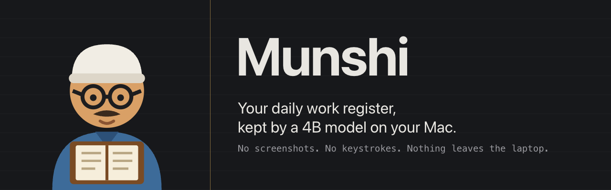
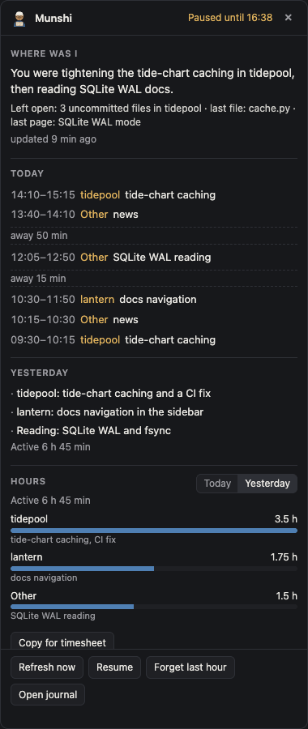
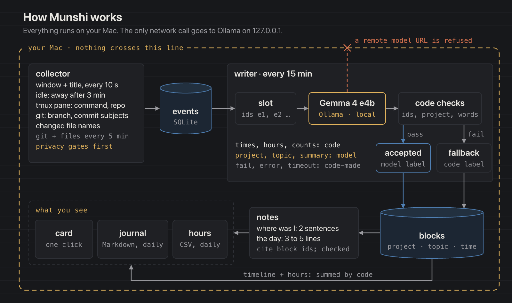
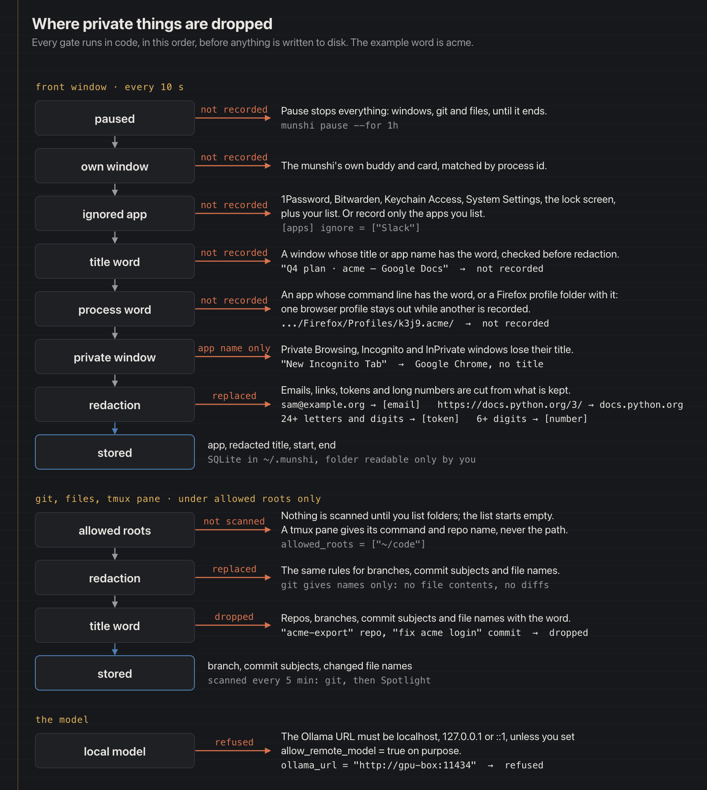

# Munshi

Your daily register, kept by a 4B model on your Mac.

A small munshi (a clerk with spectacles, a cap and a ledger) sits on your Mac's desktop and keeps your register for you. It notes which app and window are in front and, for folders you choose, the git branch, commit subjects and changed file names. Every 15 minutes a local open-weight model (Gemma 4 e4b through Ollama) turns that into plain lines, and code checks every one. Click the munshi and one card tells you **where you were**, **what you did today and yesterday**, and **your hours per project**, ready to paste wherever you need them. Personal projects, study, writing, freelancing, open source: you never keep a log by hand or rebuild yesterday from memory.

## Demo

<!-- demo video: the owner drags docs/demo/munshi-demo.mp4 in on github.com -->

Both shots are the made-up demo days (`munshi demo load`).

| The card | Paused, with yesterday's hours |
|---|---|
|  |  |

## Why

A log of every window you open is the most private data on a computer. [Rewind](https://9to5mac.com/2025/12/05/rewind-limitless-meta-acquisition/), the Mac app that remembered everything, stopped capturing on 2025-12-19 after Meta bought its maker. The record was the user's; the decision to stop was not.

So a record like this should live on your Mac, in code you can read, with a model you can swap. Munshi keeps everything in one folder that only you can read, talks only to Ollama on your own computer, and works with any model you pull. The model writes words; code checks them and computes every number.

## How it works



- **Collector.** Every 10 seconds it reads the front app and the window title (through Accessibility); after 3 minutes without input you are away. Every 5 minutes, under the folders you list, it reads git branches, commit subjects and changed file names. When a terminal's title is only `tmux`, it records the active pane's command and repo name, never the path. Every privacy gate runs before anything is written.
- **Writer and code checks.** Every 15 minutes each finished slot goes to the model with stable ids (`e1`, `e2`, …), your projects and the existing topics. The model answers JSON (window ids as evidence, project, topic, summary) at temperature 0. Code checks every answer: the ids exist and are not already taken, the project is one you have, the topic is a subject of at most 4 words and never an app name, and the summary is at most 14 words and uses words from the evidence. Projects are found by code first; the model only picks one when code found none. A rejected answer, a timeout or a missing model becomes a plain code-made line, so the timeline is never empty.
- **Notes.** After each run a "where was I" note covers the last two hours. When a day ends, a day note of 3 to 5 lines, a Markdown journal page and an hours CSV are written. Notes cite block ids and face the same checks.
- **Numbers come only from code.** Times, hours, counts and "updated 6 min ago" are computed; digits are stripped from model text, so the model never writes a number you see.

More diagrams: [one writer run](docs/img/diagrams/writer-run.png) as a sequence, [where private things are dropped](docs/img/diagrams/privacy-gates.png), and [the data model](docs/img/diagrams/data-model.png). Their sources are HTML pages in [docs/brand/](docs/brand/).

## Privacy

- Everything stays on your Mac. The only network call goes to the model on your own computer; Munshi refuses a remote model address unless you set `allow_remote_model = true` on purpose.
- It records the front app's name, the window title and, for folders you list, the git branch, commit subjects and names of changed files. No screenshots, no keystrokes, no clipboard history, no browser history, no file contents, no diffs.
- Password managers, Keychain Access, System Settings and the lock screen are never recorded, nor any app you add to the ignore list; `apps.mode = "only"` records just the apps you name. Private and incognito windows are recorded as the app name only.
- **Title words:** list words under `ignore_title_words`, such as a client's name or a private project's codename, and any window whose title (or app name) contains one is not recorded at all, as if the app were ignored. Git repos, branches, commit subjects and file names containing one are dropped too.
- **Process words:** list words under `ignore_process_words`, and any app started with a command line that contains one is not recorded. For Firefox, the name of the profile folder it has open counts too, so you can keep one browser profile out while another is recorded.
- Emails, links (only the site name is kept), tokens and long numbers are removed before anything is saved.
- No folders are scanned until you list them. **Pause** stops all recording; **Forget last hour** deletes it.
- Raw window events are deleted after 14 days. The data folder is readable only by you.
- Window titles are treated as data, never as instructions. The model has no tools, and code checks every line it writes; anything that fails becomes a plain code-made line instead.

Every gate, in the order the code runs them (the example word is `acme`):



## Quick start

Needs macOS for recording (the card preview runs anywhere). With Homebrew: `brew install uv python@3.13 ollama`, then `brew services start ollama` and `ollama pull gemma4:e4b`.

Try the demo first. It records nothing:

```sh
git clone https://github.com/prateek11rai/munshi && cd munshi
uv sync
uv run munshi demo load        # two made-up days
uv run munshi start --demo     # the munshi appears; click it
```

**Refresh now** on the card asks the model to write the demo's last three slots. Without a Mac, open the same card in a browser with `uv run munshi preview --demo` and go to <http://127.0.0.1:8765>.

To record for real:

1. `uv run munshi doctor` prints ✓/✗ for Python, macOS, Ollama, the model, Accessibility, allowed folders, the data folder and the config.
2. Give the terminal you run Munshi from Accessibility permission (System Settings › Privacy & Security › Accessibility), so window titles can be read. Without it Munshi records app names only.
3. `uv run munshi stats` creates `~/.munshi/config.toml` with comments (and shows that nothing is recorded yet). List the folders Munshi may read under `allowed_roots`, and add any title or process words before you start.
4. `uv run munshi start`. Click the munshi for the card; `uv run munshi stats` shows what was recorded or skipped, as numbers only.

## Commands

| Command | What it does |
|---|---|
| `munshi start [--demo]` | Collector and writer in the background, the munshi and its card on screen. `--demo` records nothing. |
| `munshi doctor [--demo]` | ✓/✗ for Python, macOS, Ollama, the model, Accessibility, allowed folders, data folder, config. Creates nothing. |
| `munshi demo load` / `demo clear` | Two made-up days in `./.data/demo`. |
| `munshi write [--demo]` | Run the writer once and print what it wrote. |
| `munshi journal [--date D] [--demo]` | Write and print a day's journal (default yesterday). |
| `munshi hours [--date D] [--csv] [--demo]` | Hours per project and topic (default today). |
| `munshi pause [--for 30m\|1h]` / `munshi resume` | Pause or resume recording (default: until you resume). |
| `munshi forget [--last 60m]` | Forget recent time (default the last hour). |
| `munshi preview [--demo]` | The card on <http://127.0.0.1:8765> for a browser. |
| `munshi stats [--day D] [--demo]` | Numbers only: events, polls recorded or skipped by reason, blocks accepted, rejected and fallback, seconds per slot, the app's memory, CPU and Accessibility. Never prints a title or a label. |
| `munshi eval --demo [--model M] [--slots N]` | Run the writer over the demo days and report accepted, rejected and fallback blocks, the share of active time the model labelled, and seconds per slot. |
| `munshi eval --real [--day D] [--model M]` | The same over one of your real days, in a throwaway copy of the store; numbers only. |

Prefix with `uv run` inside the repo.

## Config

`~/.munshi/config.toml` is created with comments on first run (`MUNSHI_HOME` moves the folder).

```toml
model = "gemma4:e4b"
ollama_url = "http://127.0.0.1:11434"
allow_remote_model = false
allowed_roots = []            # e.g. ["~/code", "~/Documents/notes"]
keep_events_days = 14
ignore_title_words = []       # e.g. ["acme"]: windows with this in the title are not recorded
ignore_process_words = []     # e.g. ["acme"]: apps started with this in their command line

[apps]
mode = "all"                  # or "only": record just the apps in `only`
only = []
ignore = []                   # added to the built-in list
```

Unknown keys are refused, so a misspelt privacy setting fails loudly instead of being ignored, and errors name the key, never its value. Environment overrides: `MUNSHI_HOME`, `MUNSHI_MODEL`, `MUNSHI_OLLAMA_URL`. There are no secrets and no `.env`.

Journal pages land in `~/.munshi/journal/YYYY-MM-DD.md` (Obsidian-friendly) and hours in `~/.munshi/hours/YYYY-MM-DD.csv`.

## Models

Any Ollama model works: `ollama pull <name>`, then set `model = "<name>"` or `MUNSHI_MODEL=<name>`. Compare models on the demo days with `uv run munshi eval --demo --model <name>`. The checks are the same for every model, so a weaker model means more code-made lines, never wrong numbers.

Measured with `gemma4:e4b` on an M-series Mac:

| | Demo days | Real use |
|---|---|---|
| Active time labelled by the model | 95 % | about 65 % |
| Seconds per slot | about 3 | 6.7 |

Code labels the rest of the time. At rest the app uses about 32 MB of memory and 1 % CPU; Ollama keeps the model loaded for 5 minutes after a writer run, then frees it.

Homebrew's Ollama on Apple Silicon cannot constrain a reply to a JSON schema (it answers 501). Munshi then puts the schema in the prompt and parses the reply in code, and the checks stay the same.

## Honest limits

- Recording is macOS only; the card preview runs anywhere.
- Window titles need Accessibility permission; without it Munshi records app names only.
- Browser tabs are known only by their window title; there is no browser history.
- The model is small and its summaries are plain. The real-use numbers come from the first real day's few slots, so they will move. The checks catch made-up words and numbers, not a plausible but wrong label: your eyes on the card decide.
- Title words and private windows are covered by tests but have not yet come up on a real run.
- Topics are not merged across days yet, there are no animations, nothing starts at login, and the card opens on the first display only.

## Built for Hacktoberfest 2026

Built for the [Hacktoberfest Open-Source AI Challenge, Week 3: Slow and Steady](https://dev.to/challenges/hacktoberfest-week3-2026-10-19): something with open-weight AI that rewards laziness.

**Read the post:** <!-- DEV post link -->

Two agent sessions built it: session A, the base on made-up demo data only, and session B, real recording and tuning on real numbers. <!-- session links -->

A planner session wrote each brief in [docs/design/](docs/design/) and reviewed every diff; build agents, each in its own tmux window, wrote the code. Decisions and measurements are in [docs/BUILD_LOG.md](docs/BUILD_LOG.md); the rules agents follow, and the checks they run before every commit, are in [AGENTS.md](AGENTS.md).

## After the deadline

Commits after 2026-10-26 06:59 UTC are listed here.

- Nothing yet.

## Credits and licence

- [Gemma 4](https://ollama.com/library/gemma4) through [Ollama](https://ollama.com). The model has its own licence; see its Ollama page.
- [pywebview](https://github.com/r0x0r/pywebview) (BSD 3-Clause) for the munshi and its card, and [PyObjC](https://github.com/ronaldoussoren/pyobjc) (MIT) for macOS.
- One fix (`cba1f1e`, the retry when Ollama answers 501) came from Cursor with Grok on a second Mac.
- The munshi character was drawn for this project.

MIT licence: see [LICENSE](LICENSE).
